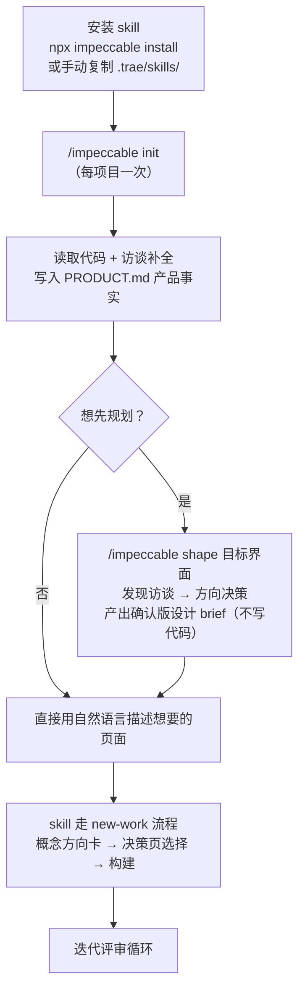

# Impeccable Skill 使用指南 —— 前端页面开发计划

> 版本：v1.0（规划阶段，未开始编码）
> 产出目录：`E:\1027--first_project\pyknora\front-end page\`（计划文档与后续开发代码统一存放于此）
> 依据来源：impeccable 仓库（`E:\1027--first_project\impeccable\`，commit `02523ae`）的 README、`skill/SKILL.src.md`、`skill/reference/*.md`，以及用户提供的三张参考截图。

---

## 一、Skill 功能梳理（前端页面的功能依据）

### 1.1 定位与核心价值

Impeccable 是一个面向编码智能体（Claude Code / Trae / Cursor / Codex 等 20+ 工具）的**设计语言 skill**，作者 Paul Bakaus，Apache 2.0 许可（源自 Anthropic 的 frontend-design skill）。解决的核心痛点：

- **AI 生成界面的"套路化"**（AI slop）：Inter 字体全家桶、紫蓝渐变、卡片套卡片、圆角方块图标等千篇一律的默认审美；
- **"Make it pop"式模糊指令**：把口语化的设计意图翻译成针对性 playbook；
- **缺少设计评审者**：agent 改完自己说好，没有独立的质量把关。

三大能力支柱：

| 支柱 | 说明 |
|---|---|
| **操控指令（Steer）** | 一个命令 + 一个目标，加载专属 playbook，如 `bolder the pricing cards` |
| **评审（Review）** | `critique` 启发式打分评审 + `audit` 技术质量报告（无障碍/性能/响应式），P0~P3 分级 |
| **检测器（Slopp Detector）** | 62 条确定性规则识别 AI 套路特征，无 LLM、无 API key |

### 1.2 完整使用流程（对应参考图片一：三步主线）

参考图片一给出的是核心工作流："先运行 init 命令 →（可选）若想先规划，中间增加一次 shape → 直接描述想做页面"。



**关键节点说明：**

1. **init（每项目运行一次）**：探索代码库 → 只问无法推断的问题（目标用户、产品定位、约束）→ 写入 `PRODUCT.md`；不涉及任何视觉决策。后续所有命令都会读取它。
2. **shape（可选的规划步）**：先访谈发现（目的/人群/结果，每轮 2~3 问）→ 解决设计方向 → 产出最小可用 brief 供确认，**到确认即停止，不写代码**。
3. **直接描述页面**：如 `/impeccable redo this hero section`，走 new-work 流程——判断既有视觉资产 →（新世界时）掷概念种子、出方向决策卡 → 按选中方向全情构建。

### 1.3 命令体系（24 个命令，5+1 类）

| 类别 | 命令 | 用途 |
|---|---|---|
| **Steer 操控**（9） | `bolder` `quieter` `distill` `colorize` `typeset` `layout` `animate` `delight` `overdrive` | 放大/收敛/提炼/上色/排版/间距/动效/个性/极限效果 |
| **Review 评审**（2） | `critique` `audit` | 启发式打分 UX 评审；技术质量报告（a11y/性能/响应式） |
| **Finish 收尾**（6） | `polish` `harden` `clarify` `adapt` `optimize` `onboard` | 上线前终磨；错误/i18n/边界；文案改写；多设备；性能；首跑流程 |
| **Iterate live 实时迭代**（2） | `live` `generate` | 浏览器内选元素循环变体；免手选批量产变体 |
| **Plan & set up 规划与配置**（4） | `shape` `init` `document` `extract` | UX 先行规划；写 PRODUCT.md；从既有代码生成 DESIGN.md；抽取设计系统 |
| 弃用别名（1） | `craft` | 普通构建请求的旧别名 |

调用形式：`/impeccable <命令> <目标>`（如参考图片二：`/impeccable critique 首页`）。无参数时弹出上下文感知菜单；`pin` 可把常用命令固定为独立快捷方式（如 `/audit`）。

### 1.4 评审循环（对应参考图片二：`/impeccable critique 首页`）

参考图片二展示的是命令输入框中的评审调用。critique 的完整机制：

- **双独立子评审**（必须隔离，防锚定）：
  - **评审 A（设计评审）**：像设计总监一样看页面——Nielsen 10 条启发式逐条 0~4 打分（满分 /40），认知负荷清单（8 项），情绪旅程，2~3 个 Persona 走查（急性子高手 Alex / 新手 Jordan / 无障碍依赖者 Sam / 边界测试者 Riley / 分心移动端 Casey）；
  - **评审 B（检测器+浏览器证据）**：跑 62 条确定性规则 + 浏览器 overlay 可视化标注。
- **综合报告**：设计健康分表、设计特异性判定、优先问题（P0 阻断 ~ P3 打磨）、persona 红旗、启发性问题；
- **快照与趋势**：结果存 `.impeccable/critique/`，可看最近 5 次分数趋势（如 24 → 28 → 32 → 29 → 32）；
- **收尾必问**：基于发现提 2~4 个带选项的问题 → 按用户回答输出推荐命令序列（最终一步总是 `polish`）。

### 1.5 Live 实时迭代（对应参考图片三：`Impeccable live` 徽标）

参考图片三的 "Impeccable live" 徽标即 live 模式激活状态。机制：

1. `/impeccable live` 启动（要求本地 dev server + HMR：Vite/Next/SvelteKit/Astro/Nuxt/纯 HTML 均可）；
2. 浏览器出现全局工具栏（含 "Impeccable live" 状态徽标），**在页面上直接点选元素** → 选设计动作 → 可加批注/涂鸦；
3. Agent 按品牌身份锁定 + 三条不同主轴，**热替换生成 3 个变体**（HMR 原地切换，不刷新页面）；
4. 每个变体可带 0~4 个实时参数旋钮（密度/色彩量等，CSS 变量驱动，零再生成本）；
5. **Accept** 后写回源码并清理脚手架，**Discard** 还原；
6. 仅限本地 checkout，不注入生产站点。

### 1.6 关键概念词典（页面需向用户解释的术语）

| 概念 | 含义 |
|---|---|
| `PRODUCT.md` | 产品事实层：用户、定位、约束、品牌承诺（init 产出，绝不放视觉决策） |
| `DESIGN.md` | 视觉系统层：字体、色板、组件语言（document 从既有代码提取） |
| Surface brief | 单界面策略层：某路由/页面的方向契约（THESIS/STORY/FIRST VIEWPORT 等六块） |
| `.impeccable/` | 工作目录：config、critique 快照、live 会话等 |
| 四种访客模式 | Persuade（说服转化）/ Operate（完成任务）/ Read（阅读理解）/ Experience（沉浸体验）——野心与克制程度随模式伸缩 |
| 检测器三运行方式 | ① agent 内 hook（编辑 UI 文件后自动跑）② CLI（`npx impeccable detect`，可扫目录/URL/CI）③ Chrome 扩展 overlay |
| buildPath | comp-first（先生成高保真效果图再照建，更大胆更慢）/ code-first（直接代码构建，更精简更快） |

---

## 二、页面定位与信息架构

### 2.1 页面定位

做一个**单页使用指南（Interactive Guide）**，让从未接触过 impeccable 的 Trae 用户在 5 分钟内理解其价值、10 分钟内跑通第一条命令，并可作为老用户的速查手册。内容型为主、演示交互为辅——本身即 skill 所倡导的 Read 模式设计（结构服务理解，阅读体验值得停留）。

### 2.2 信息架构（自上而下的叙事线：是什么 → 怎么装 → 怎么用 → 怎么查 → 怎么排障）


---

## 三、页面结构设计

### 3.1 整体布局

- **桌面端（≥1024px）**：左侧固定窄导航栏（章节锚点 + 当前位置高亮 + 顶部搜索入口），右侧内容单栏（max-width ~760px 阅读最优），演示组件可破格全宽；
- **移动端（<768px）**：导航折叠为顶部抽屉，内容单栏，演示组件降级为纵向步骤。

### 3.2 分区线框与内容要点

| # | 区块 | 内容要点 | 视觉/组件 |
|---|---|---|---|
| 0 | **Hero** | 一句话定位："给你的编码智能体的设计词汇表——用 `polish` 和 `bolder` 操控，用 `critique` 和 `audit` 评审，在 AI 套路上线前抓住它"；Before/After 对比（复刻 README 的 Villa Castagneto 案例布局，用占位说明） | 双栏对比卡 + 主 CTA「开始安装」 |
| 1 | **安装** | 三种方式：`npx impeccable install`（推荐）/ 手动复制 `.trae/skills/impeccable`（本仓库已就位）/ git submodule；装后**重启 Trae** 提示 | Tab 切换三种方式 + 命令行样式代码块（一键复制） |
| 2 | **核心工作流** | **重点复刻参考图片一的三步流程**：init → （可选 shape）→ 直接描述页面；每步一张卡片：做什么 / 说什么 / 产出什么 | 垂直 Stepper（三节点，中间节点带"可选"徽标与分支说明），箭头动画呼应原图 |
| 3 | **命令速查** | 24 命令按 5 类分组表格：命令名（等宽字体）+ 一句话用途 + 适用场景；支持关键字过滤与类别筛选 | 搜索框 + 类别 pill 筛选 + 表格；命令名可点击弹出详情抽屉（含示例 `/impeccable bolder 定价卡片`） |
| 4 | **评审循环** | 以参考图片二的 `/impeccable critique 首页` 为入口演示：双评审示意 → 健康分表（10 启发式 0~4 分）→ P0~P3 优先问题 → 趋势折线（24→28→32）→ 推荐命令序列 | 分步演示组件：输入框回放动画 + 模拟评分表 + mini 折线图 |
| 5 | **Live 实时迭代** | 以参考图片三的 "Impeccable live" 徽标开场：点选元素 → 3 变体热切换 → 参数旋钮 → Accept 写回 | **交互式模拟器**：一个静态示例卡片，用户点"生成变体"后在 3 个预置样式间热切换，滑杆实时调 CSS 变量 |
| 6 | **上下文文件机制** | PRODUCT.md / DESIGN.md / surface brief 三层金字塔：各管什么、谁写入、何时读 | 三层堆叠图 + 每层展开示例片段 |
| 7 | **检测器** | 62 规则三运行方式（agent hook / CLI / 浏览器扩展）；退出码语义（2=有发现）；忽略配置一行示例 | 三列卡片 + 终端输出模拟 |
| 8 | **FAQ 与排障** | doctor 命令、常见问题（live 连不上/检测误报/CSP 注意）、TELEMETRY 说明 | 手风琴列表 |
| — | **页脚** | 版本、许可（Apache 2.0）、上游仓库链接、本页由 impeccable 流程规划的声明 | 简洁单行 |

---

## 四、交互逻辑设计

### 4.1 全局交互

| 交互 | 行为 |
|---|---|
| 滚动位置跟踪（scrollspy） | 侧导航当前章节高亮；进入新章节时 URL hash 同步（可分享锚点） |
| 顶部搜索 | 聚焦命令速查：输入即过滤 24 命令 + 章节标题联合匹配，`Esc` 清空 |
| 键盘导航 | `↑/↓` 在搜索结果间移动，`Enter` 跳转，`/` 快捷聚焦搜索（向 agent 命令习惯致敬） |
| 复制按钮 | 所有代码块右上角，点击后图标切换 ✓ 2 秒（无需 toast） |

### 4.2 核心演示组件的状态机

**① 工作流 Stepper（对应图片一）**

```
状态：stepIndex ∈ {1, 2, 3}
事件：点击节点 / 自动播放按钮
转移：1 → 2 → 3 线性推进；节点 2 展示「可选」分支标注（若想先规划 → shape；否则直接跳 3）
进入节点时：该卡片展开详情（做什么/输入示例/产出物），其余收起
```

**② 命令输入回放（对应图片二）**

```
状态：idle → typing → sent → report
idle：输入框占位「试着输入 /impeccable critique 首页」
typing：用户键入或点击示例 chip 后，光标闪烁逐字回放
sent：回车后 loading 态（模拟评审 A/B 并行的小动画）
report：展开模拟评分表 + P0~P3 问题列表 + 趋势折线
```

**③ Live 变体切换器（对应图片三）**

```
状态：badge(off) → badge(live) → element-selected → generating → variant[i] → accepted
badge(on)：页角出现 "Impeccable live" 徽标（复刻图片三样式）
选元素：示例卡片 hover 出现蓝色描边 + 点选确认
生成：3 个预置变体（同品牌不同主轴：层级/密度/色彩策略），V1/V2/V3 切换按钮 + 左右箭头
参数旋钮：2 个 range 滑杆直改示例卡片的 CSS 变量（--p-density/--p-color），零延迟
Accept：按钮按下 → 徽标闪绿 → 显示「已写回源码」提示 → Discard 可撤销回初始
```

### 4.3 动效原则

- 动效服务于状态反馈（生成中、已接受），不做装饰性动画；
- 所有交互组件 `prefers-reduced-motion` 下降级为直切；
- 演示区滚动进入视口一次后触发（IntersectionObserver），不重复打扰。

### 4.4 无障碍基线

- 全部交互可用键盘完成，焦点环可见；
- 演示组件加 `aria-live="polite"` 播报状态；折叠区正确 `aria-expanded`；
- 正文对比度 ≥ 4.5:1（页面自身先过 audit，形成"以身作则"的卖点）。

---

## 五、功能模块划分（组件树）

```text
App
├── Layout
│   ├── SideNav（锚点导航 + scrollspy + 搜索入口）
│   ├── ContentContainer（单栏阅读区）
│   └── Footer
├── sections/（8 个内容区，纯静态为主）
│   ├── HeroSection（含 BeforeAfterCard）
│   ├── InstallSection（InstallTabs + CodeBlock）
│   ├── WorkflowSection（WorkflowStepper ★核心）
│   ├── CommandReference（CommandSearch + CategoryFilter + CommandTable + DetailDrawer）
│   ├── CritiqueSection（CommandReplay ★核心 + ScoreTable + TrendChart + IssueList）
│   ├── LiveSection（LiveSimulator ★核心：Badge + DemoCard + VariantSwitcher + ParamKnobs）
│   ├── ContextFilesSection（LayerPyramid）
│   ├── DetectorSection（ThreeWayCards + TerminalMock）
│   └── FaqSection（Accordion）
├── components/common（CodeBlock/CopyButton/Pill/Card/Badge 等基础件）
└── data/（commands.ts 命令清单、faq.ts、示例报告数据——内容与视图分离，便于后续同步上游文档）
```

**模块优先级**：三个 ★ 核心演示组件承载页面差异化价值，优先实现；内容区次之；锦上添花（趋势图、详情抽屉）最后。

---

## 六、技术选型说明

| 方案 | 组合 | 优势 | 代价 | 结论 |
|---|---|---|---|---|
| **A（推荐）** | **Vite 5 + React 18 + TypeScript + Tailwind CSS** | 三个核心演示组件（Stepper/回放/模拟器）本质是状态机，组件化最顺手；TS 保证命令数据表类型安全；构建快、产物纯静态可任意托管 | 需 Node 工具链 | ✅ 采用 |
| B | Astro + 少量 React 岛 | 内容站默认零 JS、SEO 好 | 双框架心智负担，交互岛较多时优势缩小 | 备选 |
| C | 纯静态 HTML/CSS/JS | 零构建双击即开 | 8 个分区 + 3 个状态机组件，手写状态管理易失控 | 不采用 |

**配套约定**：

- 不引入 UI 大库（避免 skill 自己批评的"卡片套卡片"默认审美）；图标用 `lucide-react`；图表（趋势折线）手写 SVG，不为一条折线引库；
- 数据层 `data/commands.ts` 单一来源对齐上游 `skill/SKILL.src.md` 的命令表，上游更新时只改这一处；
- 产物为纯静态 `dist/`，可直接以静态文件方式打开或挂到任意静态服务；
- 开发过程本身按 impeccable 流程走（先 `shape` 出本计划的 brief → 构建 → `critique` 自审），既保证质量也验证文档准确性。

---

## 七、开发阶段划分与时间节点

以启动日为 T0，按工作日排期（日历日期待项目启动后回填）：

| 阶段 | 内容 | 交付物 | 时间节点 |
|---|---|---|---|
| **M0 规划冻结** | 本计划评审通过；确定视觉方向（Persuade/Read 模式定位、配色与字体策略——避免 skill 检测器点名的套路脸） | 冻结版计划 + 视觉方向 brief | T0 ~ T0+1 |
| **M1 骨架与内容** | Vite 脚手架、布局（侧导航+单栏）、8 个内容区静态版、`data/` 命令数据表 | 可读的静态全量页面 | T0+2 ~ T0+4 |
| **M2 核心演示组件** | WorkflowStepper、CommandReplay、LiveSimulator 三个状态机组件及动效 | 三大交互全部可用 | T0+5 ~ T0+8 |
| **M3 辅助交互** | 命令搜索/筛选/详情抽屉、复制按钮、趋势图、FAQ 手风琴、键盘导航 | 功能全集完成 | T0+9 ~ T0+10 |
| **M4 响应式与无障碍** | 移动端适配、reduced-motion、对比度与焦点检查、aria 补全 | 全断点可用版本 | T0+11 ~ T0+12 |
| **M5 自审与交付** | 用 impeccable `critique` + `audit` 自审并修复 P0/P1；构建 `dist/`；交付说明 | 上线版 + 审计报告存档 | T0+13 ~ T0+14 |

**里程碑验收口径**：M2 结束时页面已具备全部差异化价值（可提前给用户试用收集反馈）；M5 的 critique 自评分 ≥ 28/40（Good 档）且无 P0。

---

## 八、验收标准、风险与边界

### 8.1 验收标准

1. 内容准确性：24 命令、工作流三步、live 机制与上游仓库文档一致（以 commit `02523ae` 为基线）；
2. 三张参考图片的信息点全部落地：图片一 → 工作流 Stepper；图片二 → critique 命令回放；图片三 → live 徽标与变体模拟；
3. 键盘可完整操作；正文对比度达标；移动端 390px 宽无横向滚动；
4. Lighthouse 无障碍 ≥ 95；纯静态构建无运行时依赖。

### 8.2 风险与对策

| 风险 | 对策 |
|---|---|
| 上游 skill 迭代快（24 命令、规则数会变） | 数据集中在 `data/` 层，页面标注"基于上游 commit 02523ae"；不做硬编码散落 |
| 演示组件与真实行为有出入造成误导 | 演示区明确标注"交互模拟"，并提供指向官方文档的链接 |
| 视觉上落入 skill 自己批评的 AI 默认审美 | M0 视觉方向单独决策；M5 用检测器自审形成闭环 |

### 8.3 边界声明

- 本阶段仅交付本计划文档，**未编写任何代码**；
- 所有前端计划文档与后续代码统一存放于 `pyknora/front-end page/`，不改动该目录以外的任何项目文件；
- `E:\1027--first_project\impeccable\` 为上游参考仓库（只读），不纳入本页面工程。
